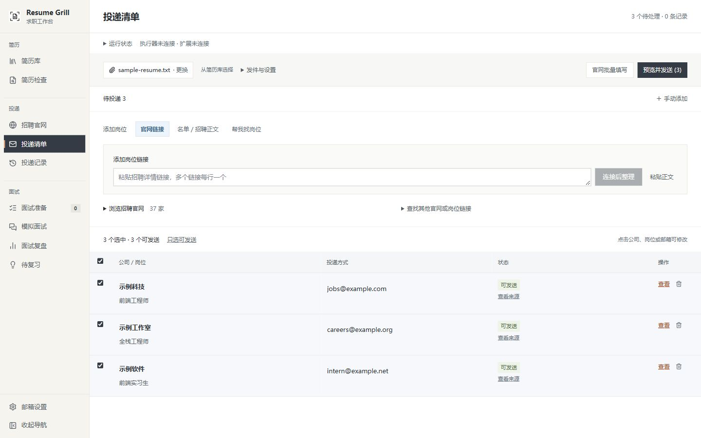
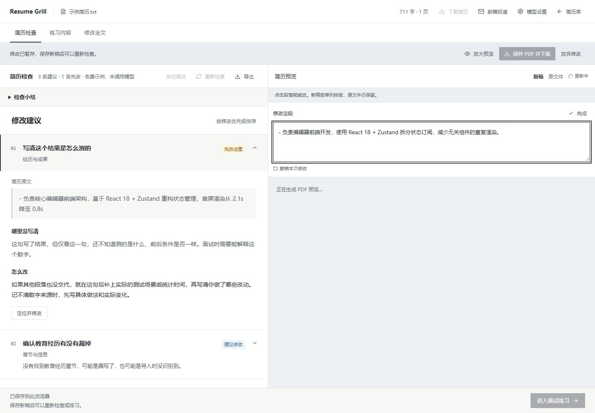
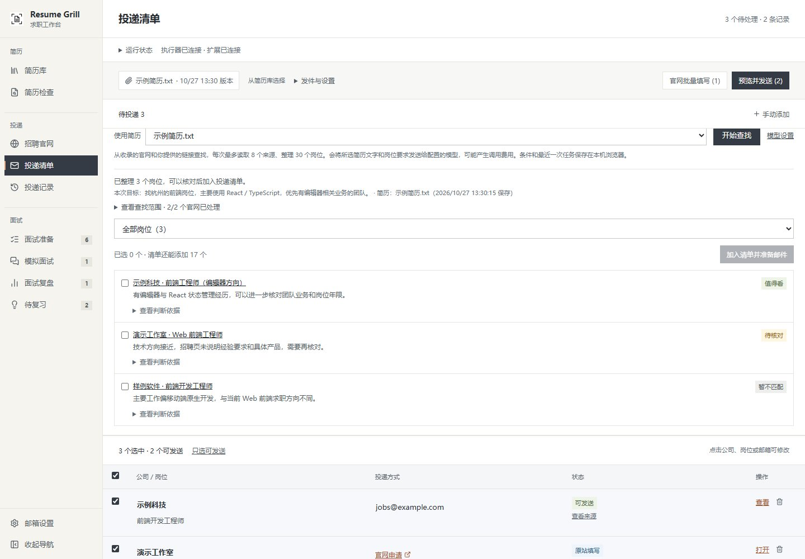
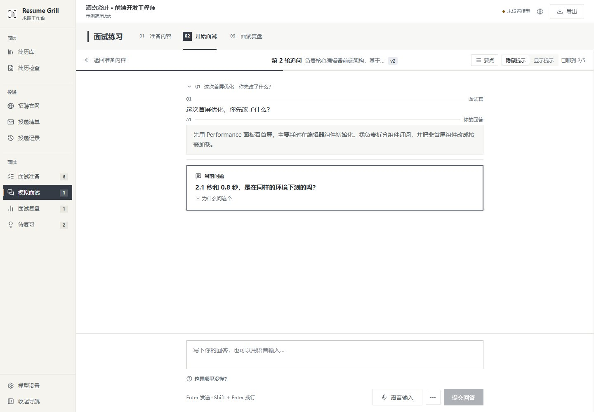
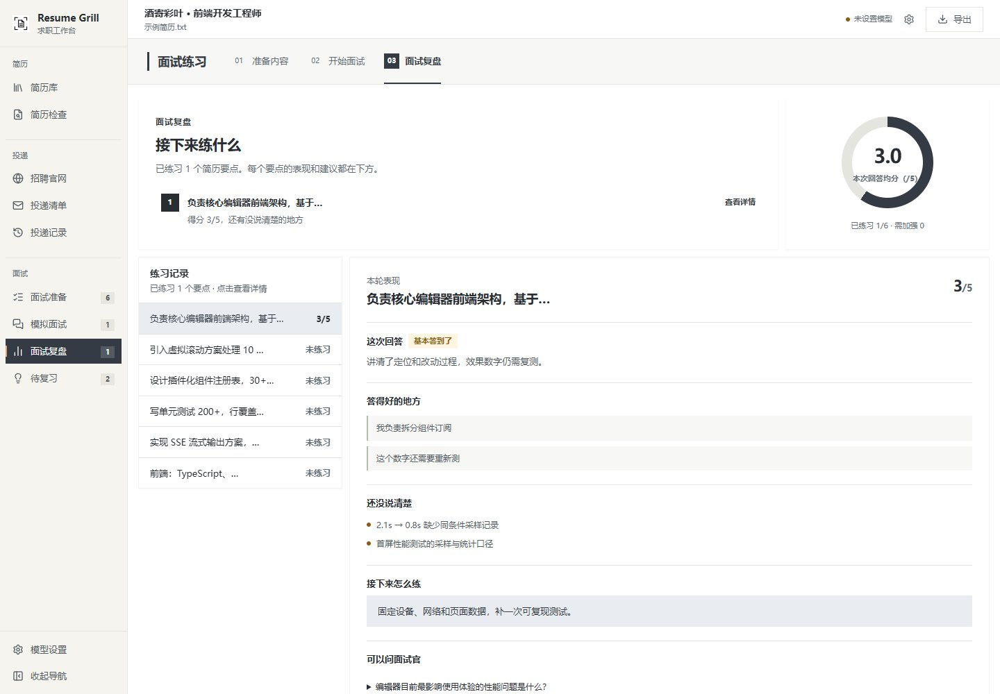

<p align="center"></p>
<h1 align="center">Resume Grill</h1>

<p align="center">
  
  
  
  
  
  
   <a href="https://linux.do/"></a>
</p>

本地优先的求职工作台：改简历、找岗位、准备投递、练习面试。各功能可以独立使用。

文档处理：PDF.js / pdf-lib / mammoth · 本地存储：IndexedDB · 邮件：Nodemailer。

## 功能

| 功能 | 支持内容 |
| --- | --- |
| 简历库 | PDF／DOCX／TXT／Markdown、粘贴文字、多份简历；版本关系与比较；可选本机文本快照与副本导入 |
| 简历检查 | 独立检查与逐条修改；技术关键词覆盖雷达、事实补充；复用资料新建简历，支持上传照片 |
| 简历修改 | 原 PDF 上定位与修改、保留照片和排版；可选八种模板重新排版 |
| 职位清单 | 已读取岗位的完整列表；按校招／社招、岗位方向、公司和关键词筛选，结果缓存在本机 |
| 岗位整理 | 网页提取、多职位选择、CSV／TSV 与招聘正文导入 |
| AI 找岗位 | 交给 AI 动态读取官网、关键词搜索、失败自动换源；按简历核对匹配依据，支持暂停、继续与重试 |
| 邮箱投递 | 只填邮箱直接投递；可根据 JD 核对修改、生成岗位版 PDF 并随邮件发送 |
| 官网填写 | 独立扩展填写、资料复用、附件上传、批量任务与多段经历 |
| 投递记录 | 邮件状态、官网／内推／手动登记；列表与漏斗看板、下一轮面试类型、增删改查与撤销 |
| 岗位详情 | 集中查看 JD、投递附件快照、邮件内容、岗位练习与真实面试笔记 |
| 面试准备 | 选择练习内容、调整优先级、回答要点与准备标记 |
| 模拟面试 | 按回答追问、单题重答与历史回答、代码／架构草稿、结构提示、计时、语音输入；按面试类型和风格调整追问 |
| 面试复盘 | 问答回看、知识与表达问题、反问建议、改写对比与多次练习 |
| 待复习 | 自动收集问题、SM-2 闪卡日程、自测检验、5 分钟盲点突击；真实面试笔记／转写复盘并加入复习 |
| 配置与导出 | 自备模型接口和 Key、连接测试、Markdown／JSON 导出 |

真实面试录音可通过已配置服务的音频转写接口导入，需单独填写该服务支持的转写模型；也可直接粘贴文字。录音转写和模型检验仅在主动操作时调用，可能产生服务商费用。关键词覆盖仅作字面检查，不代表 ATS 通过概率。复习日程参考 [SM-2 原始算法](https://super-memory.com/english/ol/sm2.htm)。

设置中可切换深浅主题。多页 PDF 按可视区加载；小屏练习页使用顶部选择器，桌面支持 ↑／↓ 或 J／K 切换、空格加入练习清单。

## 界面



<table>
  <tr>
    <td width="50%"><br>简历修改</td>
    <td width="50%"><br>岗位匹配</td>
  </tr>
  <tr>
    <td><br>模拟面试</td>
    <td><br>面试复盘</td>
  </tr>
</table>

## 启动

需要 Node.js ≥ 22.13，推荐 Node.js 24。

```bash
npm ci
npm run dev
```

打开 [localhost:3000](http://localhost:3000)，点击「试用示例简历」体验。模型功能需在「设置 → 模型」填写 Base URL、API Key 和 Model。

读取官网或发送邮件时，将启动命令换成 `npm run dev:local`，按页面提示连接本机。扩展安装、模型配置和部署步骤见[使用说明](docs/getting-started.md)。

当前为 Beta。官网填写的覆盖范围见[适配记录](docs/website-adaptation.md)，最终申请由你核对提交；暂不支持 BOSS 自动投递。语音输入取决于浏览器支持。数据主要保存在本机，清理站点数据前请备份。

## 文档

[使用与配置](docs/getting-started.md) · [邮箱投递](docs/email-applications.md) · [官网扩展](docs/website-automation.md) · [招聘目录](docs/career-directory.md) · [参与开发](CONTRIBUTING.md)

代码入口在 `src/application/`，业务按模块放在 `src/features/`。投递模块分为职位 `jobs/`、邮件 `mail/`、官网填写 `website/` 和记录 `history/`；AI 找岗位独立放在 `job-assistant/`。模块职责见 [目录说明](src/features/README.md)，开发约定见 [AGENTS.md](AGENTS.md)。

`server/` 是实验中的 [Go + SQLite 服务](docs/go-service.md)，按入口、HTTP、存储三层组织，支持迁移、健康检查和可选文本快照；现有工作台仍可独立使用。

[MIT License](LICENSE)
