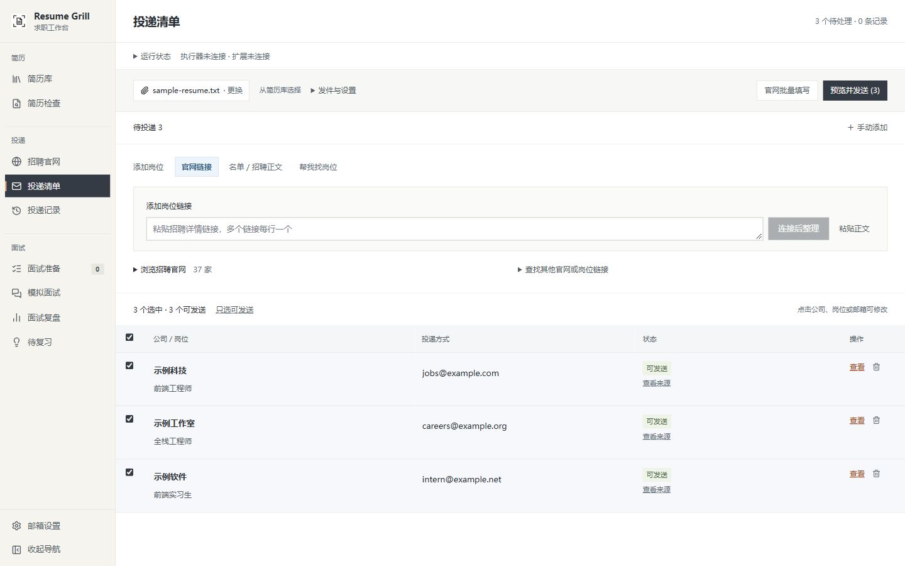
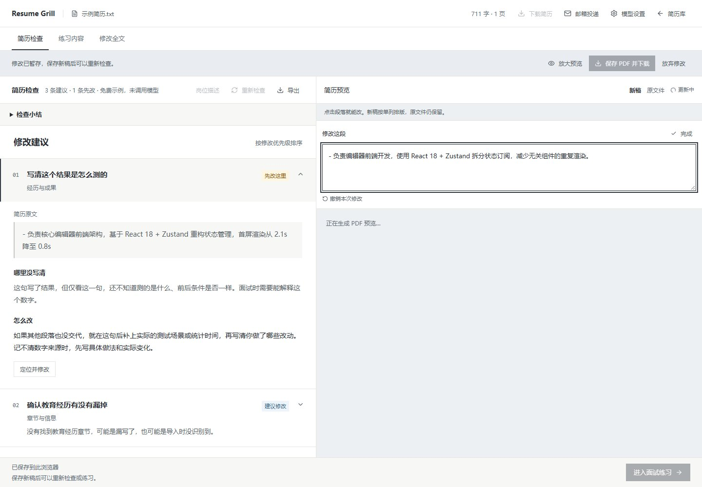
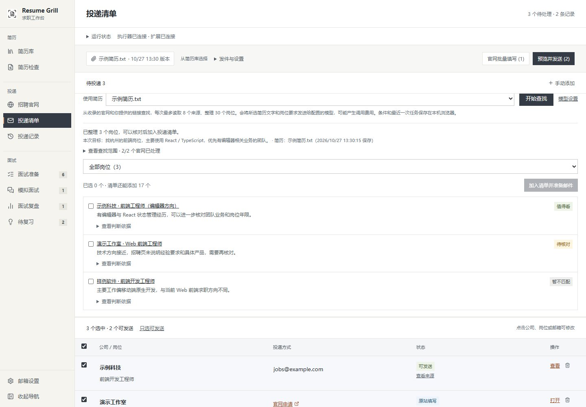
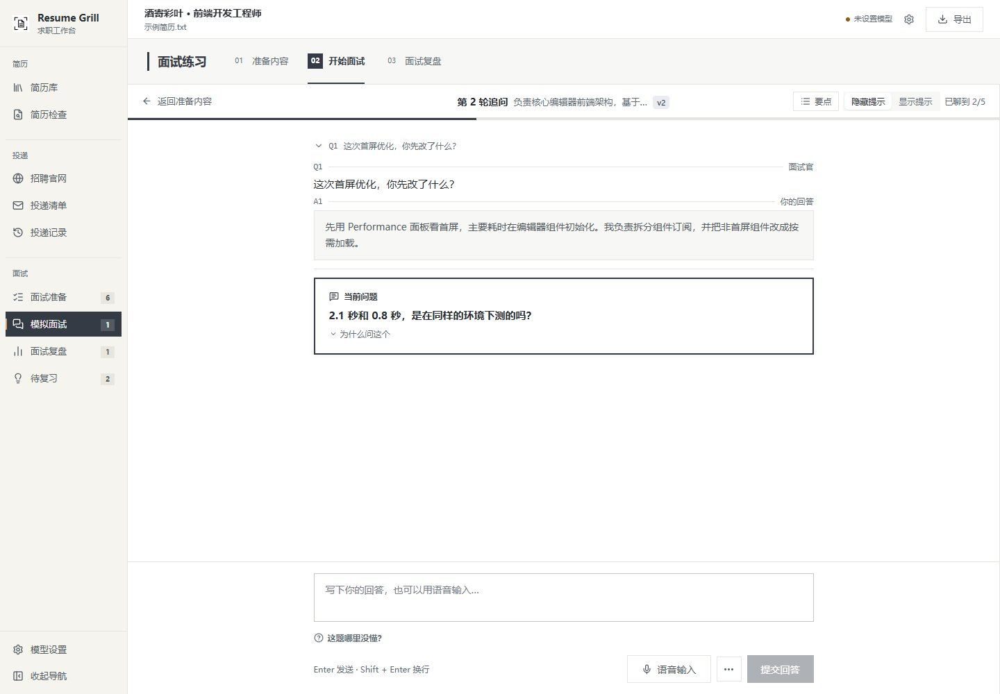
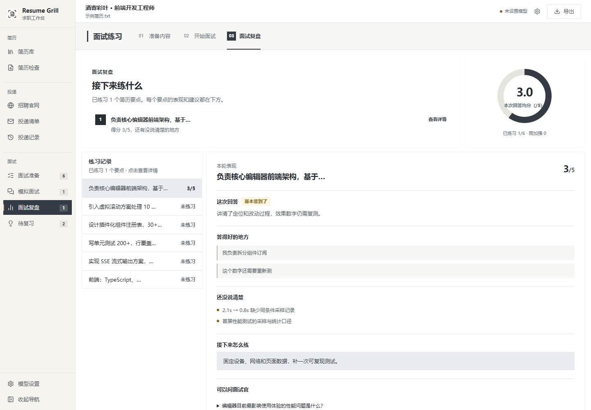

<p align="center"></p>
<h1 align="center">Resume Grill</h1>

本地优先的求职工作台：改简历、找岗位、准备投递、练习面试。各功能可以独立使用。

## 功能

| 功能 | 支持内容 |
| --- | --- |
| 简历库 | PDF／DOCX／TXT／Markdown、粘贴文字、多份简历 |
| 简历检查 | 内容、结构、表达检查，结合 JD 核对岗位要求 |
| 简历修改 | 原 PDF 上定位与修改、保留照片和排版；可选八种模板重新排版 |
| 招聘官网 | 公司招聘目录、官网和岗位链接查找 |
| 岗位整理 | 网页提取、多职位选择、CSV／TSV 与招聘正文导入 |
| 找岗位 | 按目标和简历核对匹配依据，任务暂停、继续、重试 |
| 邮箱投递 | 只填邮箱直接投递；可根据 JD 核对修改、生成岗位版 PDF 并随邮件发送 |
| 官网填写 | 独立扩展填写、资料复用、附件上传、批量任务与多段经历 |
| 投递记录 | 邮件状态、官网申请标记、队列暂停、取消与失败处理 |
| 面试准备 | 选择练习内容、调整优先级、回答要点与准备标记 |
| 模拟面试 | 按回答追问、疑问批注、跳题、练习恢复、语音输入 |
| 面试复盘 | 问答回看、知识与表达问题、反问建议、改写对比与多次练习 |
| 待复习 | 自动收集问题、手动笔记、状态与来源筛选 |
| 配置与导出 | 自备模型接口和 Key、连接测试、Markdown／JSON 导出 |

## 界面



<table>
  <tr>
    <td width="50%"><br>简历修改</td>
    <td width="50%"><br>岗位匹配</td>
  </tr>
  <tr>
    <td><br>模拟面试</td>
    <td><br>面试复盘</td>
  </tr>
</table>

## 启动

需要 Node.js ≥ 22.13，推荐 Node.js 24。

```bash
npm ci
npm run dev
```

打开 [localhost:3000](http://localhost:3000)，点击「试用示例简历」体验。模型功能需在「模型设置」填写 Base URL、API Key 和 Model。

读取官网或发送邮件时，将启动命令换成 `npm run dev:local`，按页面提示连接本机。扩展安装、模型配置和部署步骤见[使用说明](docs/getting-started.md)。

当前为 Beta。官网填写的覆盖范围见[适配记录](docs/website-adaptation.md)，最终申请由你核对提交；暂不支持 BOSS 自动投递。语音输入取决于浏览器支持。数据主要保存在本机，清理站点数据前请备份。

## 文档

[使用与配置](docs/getting-started.md) · [邮箱投递](docs/email-applications.md) · [官网扩展](docs/website-automation.md) · [招聘目录](docs/career-directory.md) · [参与开发](CONTRIBUTING.md)

Next.js / React / TypeScript / Tailwind CSS；PDF.js、mammoth、IndexedDB、Nodemailer。目录约定见 [AGENTS.md](AGENTS.md)。

[MIT License](LICENSE)
