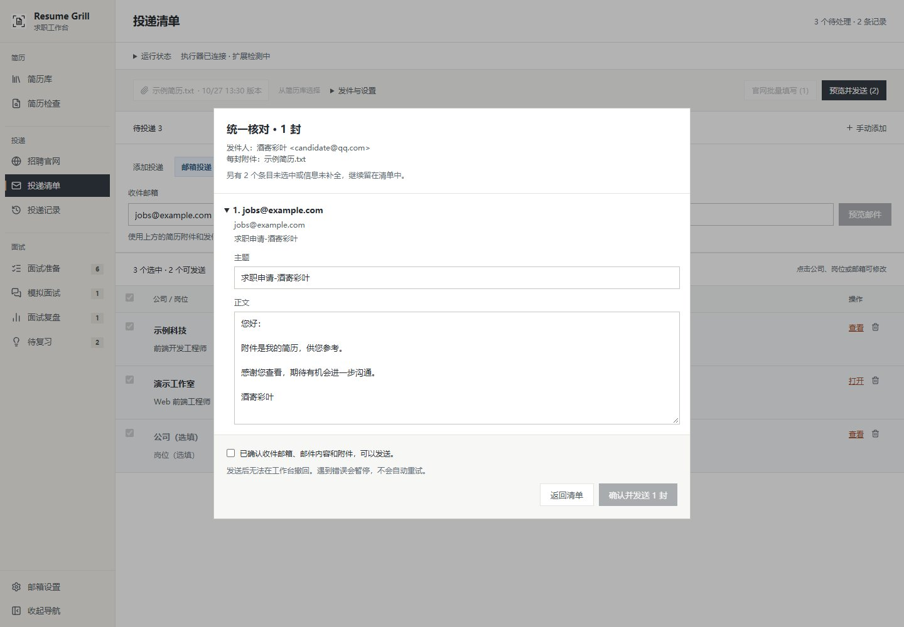
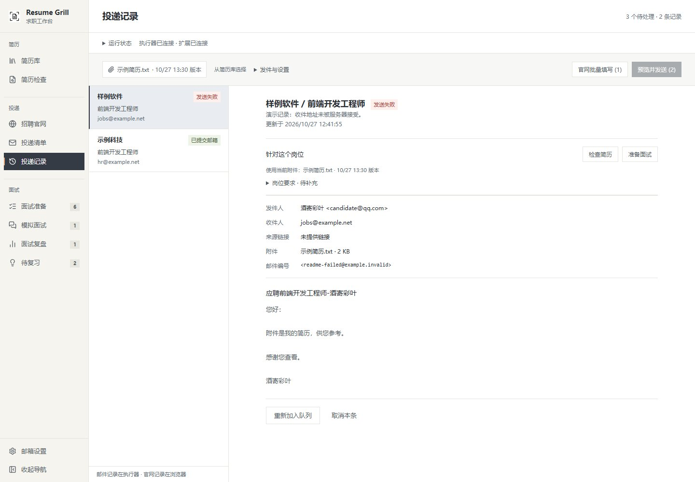
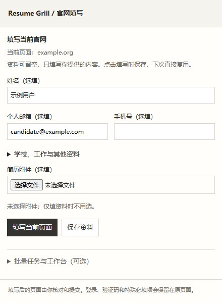
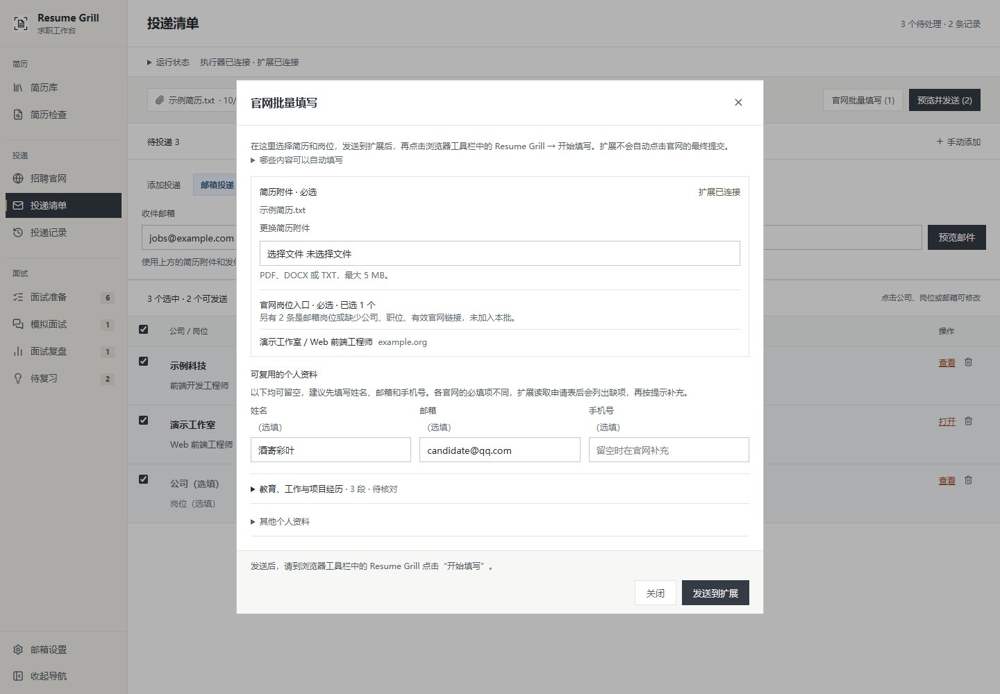
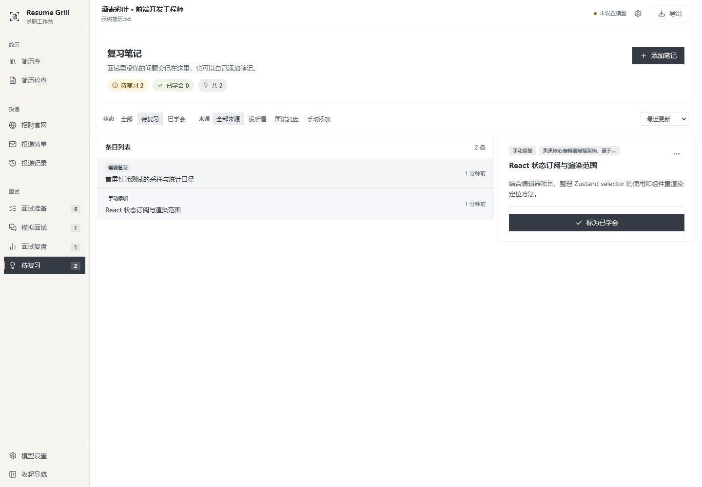
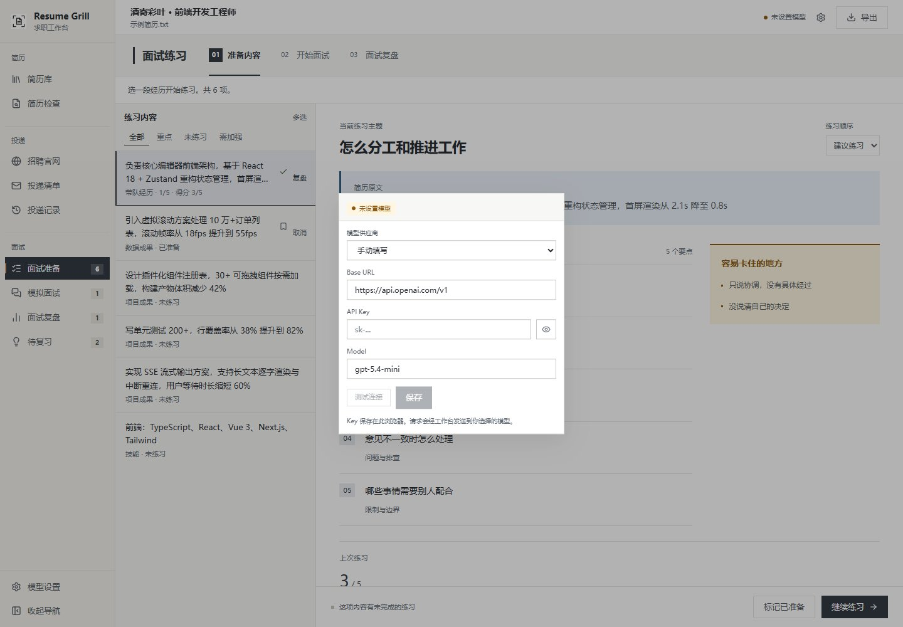

# 界面截图

[返回首页](../../README.md)

更新日期：2026-10-27。网页截图为 1440 × 1000，扩展面板为 440 × 600，均来自当前代码渲染的界面。

使用独立浏览器会话和内置示例简历，不读取日常浏览器的个人资料。岗位、匹配结果、问答与邮件记录使用虚构数据和 `example.com` 等示例地址；连接状态由截图会话模拟，扩展面板使用模拟的浏览器 API 加载当前构建文件。没有调用付费模型、运行邮箱执行器、发送邮件或提交申请，也不表示招聘官网已完成适配实测。

| 截图 | 内容 |
| --- | --- |
| [applications.jpg](applications.jpg) | 直接输入收件邮箱、复用简历、查看投递清单 |
| [home.jpg](home.jpg) | 简历库、导入文件或粘贴文字 |
| [resume-review.jpg](resume-review.jpg) | 简历检查、建议优先级、原文定位 |
| [resume-edit.jpg](resume-edit.jpg) | 在预览中修改选中段落 |
| [resume-preview.jpg](resume-preview.jpg) | 修改后的实际 PDF 新稿预览 |
| [career-sites.jpg](career-sites.jpg) | 招聘官网目录与岗位链接入口 |
| [job-assistant.jpg](job-assistant.jpg) | 求职目标、岗位匹配结果与判断依据 |
| [email-preview.jpg](email-preview.jpg) | 只填邮箱后预览，直接修改主题和正文 |
| [application-history.jpg](application-history.jpg) | 邮件状态、附件与失败后处理入口 |
| [website-extension.jpg](website-extension.jpg) | 独立扩展中的个人资料、选填附件与当前页填写入口 |
| [website-autofill.jpg](website-autofill.jpg) | 工作台批量交接官网岗位、个人资料与多段经历 |
| [audit.jpg](audit.jpg) | 面试准备、练习内容和回答要点 |
| [interview.jpg](interview.jpg) | 问答历史、当前追问与输入区域 |
| [report.jpg](report.jpg) | 复盘、回答依据、待补充内容与反问入口 |
| [knowledge.jpg](knowledge.jpg) | 复习笔记、状态与来源筛选 |
| [model-settings.jpg](model-settings.jpg) | 模型供应商、接口配置与连接测试 |

更新时使用示例数据重截实际页面，检查字体、PDF 渲染、弹窗边界及敏感信息，再同步根 README 中的图片和日期。

## 投递清单

## 简历：简历库、检查、段落修改与 PDF 新稿

<table>
  <tr>
    <td width="50%"> 简历库与导入</td>
    <td width="50%"> 检查建议与原文定位</td>
  </tr>
  <tr>
    <td> 段落修改</td>
    <td> PDF 新稿预览</td>
  </tr>
</table>

## 投递：招聘目录、岗位匹配、邮件预览与记录

<table>
  <tr>
    <td width="50%"> 招聘官网</td>
    <td width="50%"> 求职目标与岗位匹配</td>
  </tr>
  <tr>
    <td> 邮件预览与修改</td>
    <td> 投递记录</td>
  </tr>
</table>

## 官网填写：独立扩展与批量资料、经历复用

扩展面板可独立使用；截图使用本地演示资料，不代表第三方官网已经完成实测。

## 面试：练习准备、模拟问答、复盘与待复习

<table>
  <tr>
    <td width="50%"> 面试准备</td>
    <td width="50%"> 模拟面试</td>
  </tr>
  <tr>
    <td> 面试复盘</td>
    <td> 待复习与笔记</td>
  </tr>
</table>

## 模型配置与连接测试

